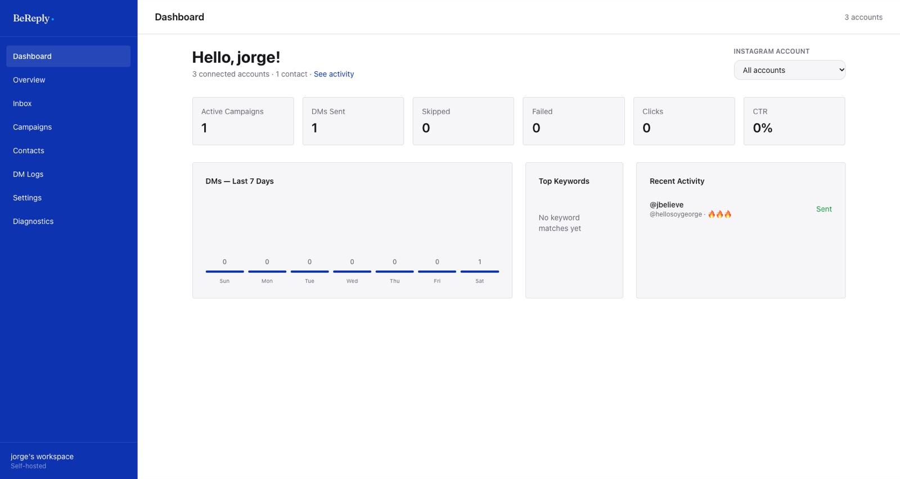

# Qué es BeReply

BeReply responde por ti en Instagram. Alguien comenta una palabra en tu reel, o te escribe por DM, o responde una historia, y en un par de segundos le llega un mensaje privado con lo que prometiste: un link, una guía, un catálogo, una respuesta.

Es la herramienta propia de Believe para lo que hacen ManyChat y similares, sin pagar por cuenta ni por asiento. Corre en la infraestructura de Believe y usa la API oficial de Meta: no raspa, no automatiza un navegador y nunca pide la contraseña de Instagram.

## Qué puede hacer

| Capacidad | En qué consiste |
|---|---|
| Comentario a DM | Una palabra clave en un comentario dispara un mensaje privado a esa persona |
| Respuesta pública | Además del DM, deja una respuesta visible bajo el comentario ("Te envié un DM") |
| DM e historias | Las mismas palabras funcionan si te escriben por DM o responden una historia |
| Follow gate | Pide que te sigan antes de entregar el link, y lo comprueba |
| Links con medición | Cada link se cambia por uno propio para contar clics y CTR por campaña |
| Respuestas con IA | En vez de un mensaje fijo, la IA contesta con base en el conocimiento de tu marca |
| Flujos | Condiciones, etiquetas, IA y catálogo encadenados en un diagrama |
| Catálogo de BeCommerce | Muestra productos reales de tu tienda como tarjetas dentro del DM |
| Contactos y etiquetas | Guarda a cada persona que interactúa y la segmenta |
| Bandeja | Lee y contesta los DMs desde el panel |

## Cómo funciona, en cinco pasos

1. Alguien comenta en tu post, te escribe por DM o responde tu historia.
2. Meta le avisa a BeReply en el momento.
3. BeReply revisa si el texto coincide con alguna campaña activa de esa cuenta.
4. Si coincide, pone el envío en cola.
5. El DM sale, y la respuesta pública si la activaste. Todo queda registrado.

Los envíos respetan el límite de Meta de 750 respuestas privadas por hora y por cuenta. Lo que pasa de ese límite espera su turno: no se pierde.

## Para quién es este manual

Para quien opera las cuentas de Instagram de una marca: crear campañas, cargar el conocimiento de la marca, leer los resultados y atender lo que la IA no resuelve. Cómo Believe administra BeReply por dentro (Meta, servidores, respaldos) está en el manual de operación.

> BeReply está en `reply.believe-global.com`. Se entra con el correo: te llega un link de acceso, sin contraseña.
