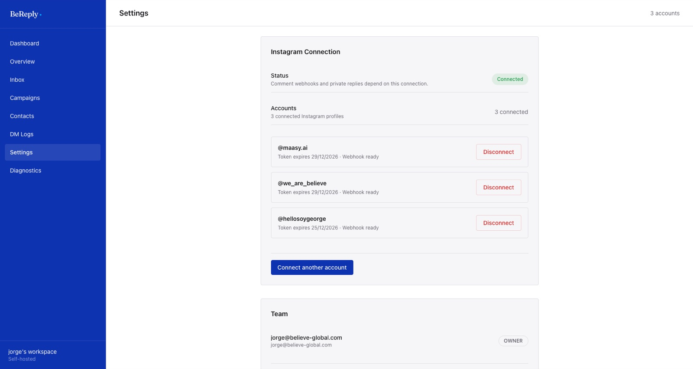

# Primeros pasos

## Entrar

1. Abre `https://reply.believe-global.com`.
2. Escribe tu correo. Te llega un link de acceso: ábrelo en el mismo navegador.
3. Solo entran los correos autorizados. Si el tuyo no está, pídele a un administrador que te invite desde **Settings → Team**.

## Conectar una cuenta de Instagram

La cuenta tiene que ser **profesional** (Empresa o Creador), no personal. Antes de conectarla, Believe la habilita en Meta como evaluadora de la app BeReply. Eso pasa una sola vez por cuenta.

1. **Acepta la invitación de Meta.** En un navegador, no en la app de Instagram, entra con la cuenta de la marca a `https://www.instagram.com/accounts/manage_access/`. Ve a la pestaña **Invitaciones de evaluador** (o *Tester invites*) y acepta **BeReply**. La app de Instagram no muestra esa pestaña; desde el celular sirve Safari o Chrome.
2. **Conéctala en BeReply.** En el mismo navegador donde Instagram tiene abierta la cuenta de la marca, entra a **Settings → Connect another account** y autoriza. Si Instagram te muestra otra cuenta, cambia antes de aceptar.
3. **Comprueba.** En **Settings** la cuenta aparece con la fecha de vencimiento del token y "Webhook ready".



> El token de cada cuenta se renueva solo todos los días. No tienes que reconectar nada mientras la cuenta siga autorizada en Instagram.

## Vincular la marca con Maasy

Antes de prender respuestas con IA, la cuenta necesita el conocimiento de su marca. Lo más rápido es traerlo del ADN de la marca en Maasy:

1. **Settings → Brand knowledge.**
2. En el primer selector elige la cuenta, por ejemplo `@we_are_believe`.
3. En el segundo elige su marca de Maasy, por ejemplo **Maasy: Believe**. BeReply trae el ADN, lo resume en una ficha para DM y lo muestra. Tarda unos 30 segundos.

Más detalle en la sección *Conocimiento de marca*.

## Tu primera campaña en dos minutos

1. **Campaigns → New Campaign.**
2. Elige la cuenta y el post (o "any post or reel").
3. Escribe la palabra clave, por ejemplo `GUIA`.
4. Escribe el DM con el link.
5. **Go Live.**
6. Comenta `GUIA` en ese post desde otra cuenta y revisa que te llegue el DM.

```pedido
GUIA
Quiero la guía
Me interesa la GUIA
```

Así se ven los comentarios que dispararían esa campaña: la palabra puede venir sola o dentro de una frase.
