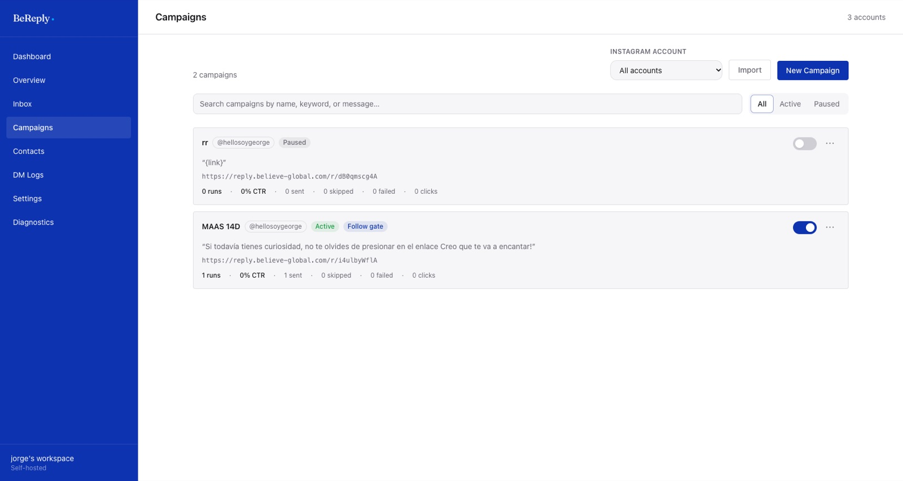
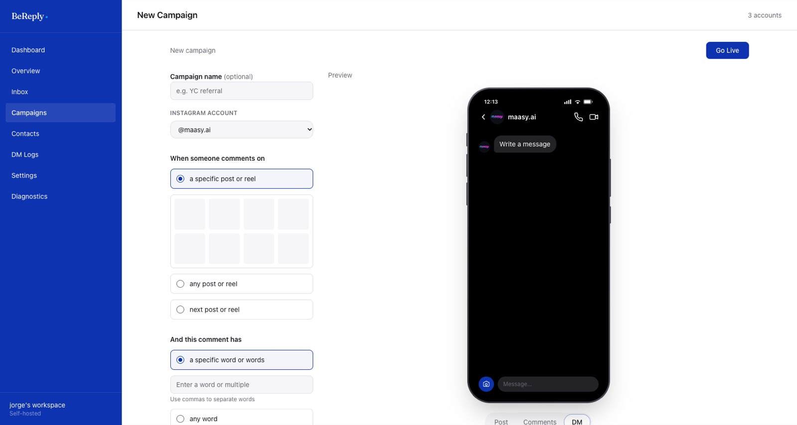
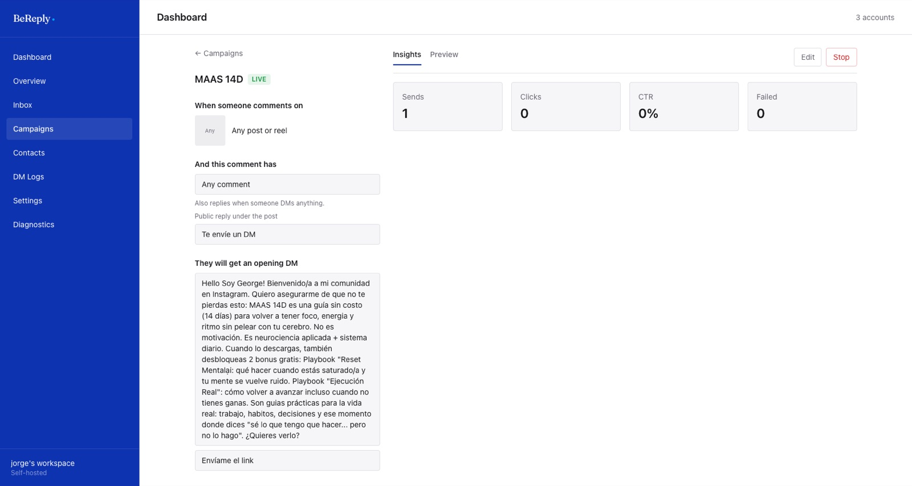

# Campañas

Una campaña es una regla: **cuando** alguien comenta o escribe tal cosa, **le llega** tal mensaje. Cada campaña pertenece a una sola cuenta de Instagram.

En **Campaigns** ves todas las campañas con su cuenta, su estado (*Active* o *Paused*), si tienen follow gate, el mensaje y sus números: corridas, CTR, enviados, omitidos, fallidos y clics. El interruptor de la derecha la prende o la pausa sin borrarla. Arriba puedes filtrar por cuenta, buscar por nombre, palabra o mensaje, e importar campañas desde un CSV.

## Crear una campaña

**Campaigns → New Campaign** abre el editor con una vista previa del DM a la derecha, tal como lo verá la persona.

### Cuándo se dispara

**When someone comments on**

| Opción | Qué hace |
|---|---|
| a specific post or reel | Solo ese post. Lo eliges de la grilla de tus publicaciones |
| any post or reel | Cualquier post de la cuenta, incluidos los anuncios hechos desde un post |
| next post or reel | El próximo que publiques. Sirve para dejar lista la campaña antes de subir el reel: BeReply la amarra sola cuando sale |

**And this comment has**

| Opción | Qué hace |
|---|---|
| a specific word or words | Una o varias palabras, separadas por comas. No importan mayúsculas ni tildes: `PRECIO` coincide con `precio` |
| any word | Cualquier comentario dispara la campaña |

Las mismas palabras pueden disparar la campaña cuando alguien **te escribe un DM** o **responde una historia**. Eso se activa por campaña y sirve para historias tipo "Responde LINK y te lo mando".

> Tus propios comentarios nunca disparan una campaña: Meta no deja mandarse un DM a uno mismo.

### Qué recibe la persona

**They will get**

- **Respuesta pública** bajo el comentario (opcional). Puedes escribir varias y BeReply rota entre ellas, para que no se vean todas iguales.
- **DM de apertura** (opcional) con un botón, por ejemplo "Envíame el link". El link llega cuando la persona toca el botón. Esto abre la conversación y mejora la entrega.
- **El mensaje** con el link. `{username}` se reemplaza por el usuario de la persona y `{link}` por el link medido.
- Hasta **dos botones de link**, cada uno medido por separado.

**And then, they will get** (opcional)

- **Follow gate**: antes de entregar el link, pide que te sigan y comprueba que lo hicieron. Si Instagram no devuelve el dato, entrega el link igual, para no dejar atrapado a un seguidor real.
- **Mensaje de agradecimiento** unos minutos después del link.

**Advanced** guarda la parte de IA: ver la sección *Respuestas con IA*.

Cuando todo está listo, **Go Live**. La campaña queda activa de inmediato.

## Ver y editar una campaña

Al abrir una campaña ves su configuración a la izquierda y, a la derecha, **Insights** (envíos, clics, CTR y fallidos) o **Preview**. **Edit** la modifica y **Stop** la pausa.

## Buenas prácticas

- Una palabra clave corta y fácil de escribir en el celular: `GUIA`, `LINK`, `PRECIO`.
- Dila en el video y en el texto del post. La gente comenta lo que ve escrito.
- Usa "next post or reel" cuando prepares un lanzamiento: la campaña queda lista antes de publicar.
- Pausa las campañas viejas en vez de borrarlas: conservan sus números.
