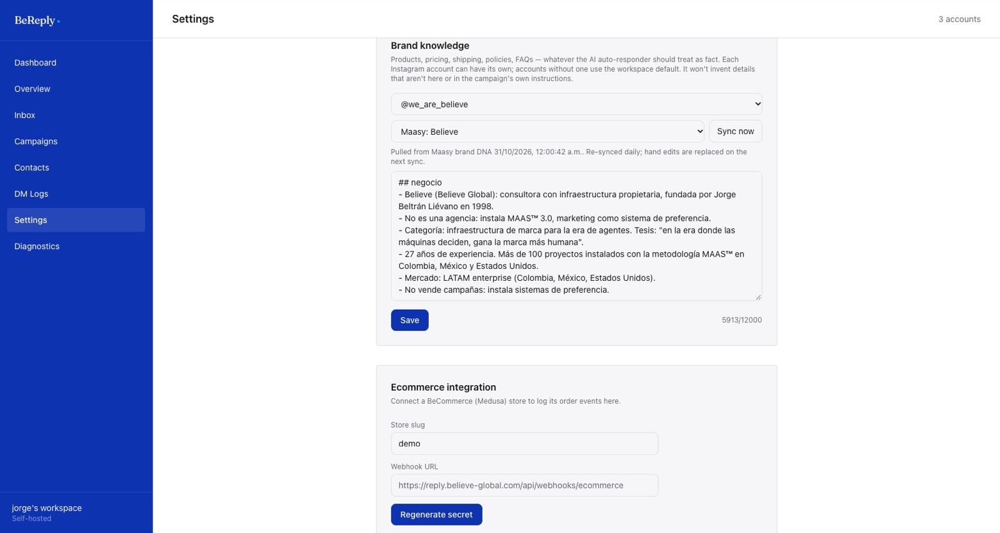

# Conocimiento de marca

El conocimiento de marca es lo que la IA trata como verdad cuando responde: qué vende la marca, precios, condiciones, sedes, horarios, preguntas frecuentes, a quién le habla y con qué tono. La IA no afirma nada sobre productos, precios, stock o políticas que no esté ahí o en las instrucciones de la campaña.



## Uno por cuenta

Cada cuenta de Instagram tiene su propio conocimiento. Así una sola persona opera varias marcas desde el mismo panel sin que la IA mezcle la información de una con la de otra.

En **Settings → Brand knowledge**, el primer selector dice de qué hablas:

| Opción | Para qué |
|---|---|
| Workspace default (all accounts) | El respaldo. Lo usan las cuentas que no tienen conocimiento propio |
| `@cuenta` | El conocimiento de esa cuenta. Si tiene, manda sobre el del workspace |

## Traerlo de Maasy (lo recomendado)

Maasy es la fuente de verdad del ADN de cada marca de Believe. Al vincular una cuenta con su marca de Maasy:

1. BeReply trae el ADN completo. Suele pesar entre 50.000 y 110.000 caracteres.
2. Lo resume en una ficha para DM de hasta 12.000 caracteres: qué vende, precios, condiciones, preguntas frecuentes, cliente ideal y voz. Deja fuera la estrategia y el análisis de competencia.
3. La guarda como el conocimiento de esa cuenta y muestra cuándo se sincronizó.

Para vincular: elige la cuenta y luego **Maasy: \<marca\>** en el segundo selector. **Sync now** vuelve a traerla cuando quieras.

> BeReply vuelve a sincronizar todas las cuentas vinculadas una vez al día, a las 05:00 UTC. Si algo de la marca cambia, cámbialo en Maasy: al día siguiente ya está en BeReply. Lo que edites a mano en una cuenta vinculada se reemplaza en esa sincronización.

## Escribirlo a mano

Si la marca no está en Maasy, o quieres algo distinto, deja el segundo selector en **Not linked to Maasy**, escribe el texto y **Save**. Va bien en frases cortas y concretas:

```pedido
Envíos a todo el país, de 3 a 5 días hábiles.
Cambios dentro de 30 días con factura.
Atención por DM de lunes a viernes, 8 a 6.
```

## Qué pasa si una cuenta no tiene conocimiento

Las campañas con mensaje fijo funcionan igual: no usan el conocimiento. Las respuestas con IA usan el del workspace y, si tampoco hay, solo las instrucciones de la campaña. Antes de prender la IA en una cuenta, revisa que tenga su ficha.
