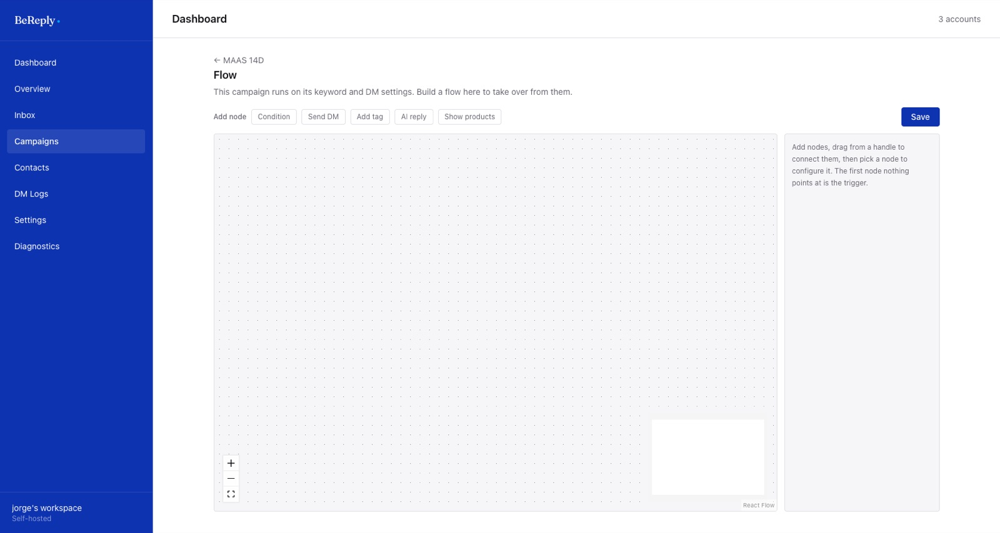

# Flujos

Un flujo reemplaza la respuesta simple de una campaña por un diagrama: primero revisa una condición, después etiqueta a la persona, luego contesta con IA o le muestra productos. Se arma con bloques que se conectan.



## Abrirlo

Abre la campaña y entra a **Flow**. Mientras el flujo esté vacío, la campaña sigue funcionando con su palabra clave y su DM. Cuando guardas un flujo, el flujo toma el control de la respuesta.

## Los bloques

| Bloque | Qué hace |
|---|---|
| Condition | Revisa algo y separa el camino. Puede mirar las **etiquetas** de la persona o el **texto** que escribió, con "incluye" o "no incluye" |
| Send DM | Manda un mensaje fijo |
| Add tag | Le pone una etiqueta a la persona, por ejemplo `cliente` o `interesado-villa` |
| AI reply | Contesta con IA, con las mismas reglas de la sección anterior |
| Show products | Manda hasta 5 productos como tarjetas, sacados en vivo de la tienda de BeCommerce conectada en **Settings → Ecommerce integration**. Puedes filtrar con una búsqueda o dejarla vacía para mostrar todo el catálogo |

## Armarlo

1. Agrega bloques con los botones de **Add node**.
2. Arrastra desde el borde de un bloque hasta otro para conectarlos.
3. Haz clic en un bloque para configurarlo en el panel de la derecha.
4. El primer bloque al que no llega ninguna flecha es el inicio.
5. **Save.**

## Ejemplo

```pedido
Condition: el texto incluye "precio"
  sí → Add tag "pidio-precio" → AI reply
  no → Send DM con el link de la guía
```

Así, quien pregunta por precio recibe una respuesta de la IA con base en la ficha de la marca, y queda etiquetado para seguirlo después. El resto recibe la guía.
