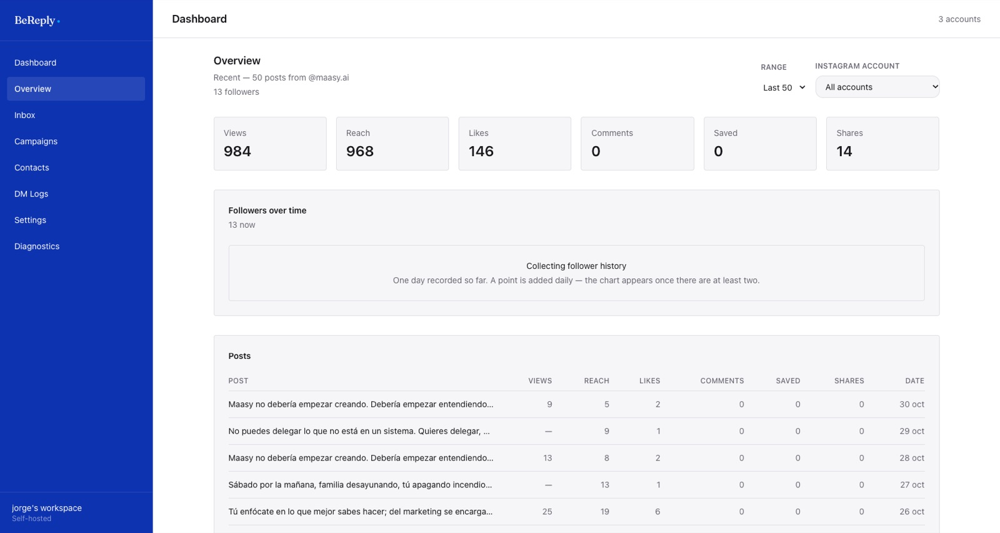

# Contactos, bandeja y resultados

## Dashboard

La primera pantalla. Resume, para todas las cuentas o la que elijas arriba a la derecha: campañas activas, DMs enviados, omitidos, fallidos, clics y CTR. Abajo, los DMs de los últimos 7 días, las palabras que más disparan y la actividad reciente.

## Overview

El desempeño de la cuenta en Instagram: vistas, alcance, me gusta, comentarios, guardados y compartidos de tus últimas publicaciones, y la curva de seguidores.

> Instagram guarda solo unos 30 días de estadísticas de la cuenta. BeReply toma una foto diaria de los seguidores para tener historia más larga: la curva aparece desde el segundo día de datos.

## Contactos

Cada persona que comenta o escribe a una cuenta conectada queda como contacto, con su usuario y sus etiquetas. Las etiquetas las pones a mano o las pone un flujo, y sirven para segmentar: un bloque *Condition* puede decidir según ellas. Si la marca tiene tienda en BeCommerce, los pedidos que llegan desde un link de BeReply quedan asociados al contacto.

## Bandeja

**Inbox** muestra las conversaciones de DM de tus cuentas y te deja contestar desde el panel. Es donde se atiende lo que la IA escaló.

> Meta solo deja contestar dentro de las **24 horas** desde el último mensaje de la persona. Pasado ese plazo, el envío falla: hay que esperar a que vuelva a escribir.

## DM Logs

Cada intento de envío queda registrado con su estado y su motivo:

| Estado | Qué significa |
|---|---|
| Sent | Llegó |
| Pending | En cola |
| Failed | Meta lo rechazó. El motivo dice por qué (ventana de 24 horas, permisos, cuenta) |
| Skipped dedup | Esa persona ya recibió el DM de esa campaña por ese comentario |
| Skipped rate limit | Se pasó el límite de Meta por hora: espera su turno |
| Skipped plan limit | Se alcanzó el límite del workspace |
| Skipped no match | El texto no coincidió |
| Skipped escalated | La IA lo pasó a una persona: no se envió nada |

## Links medidos y reportes

Cada link de una campaña se cambia por uno de `reply.believe-global.com/r/…` que cuenta los clics y lleva a tu link real. Así cada campaña tiene sus clics y su CTR. Una campaña también puede tener un reporte compartible por link, para mostrarle resultados a alguien sin darle acceso al panel.
