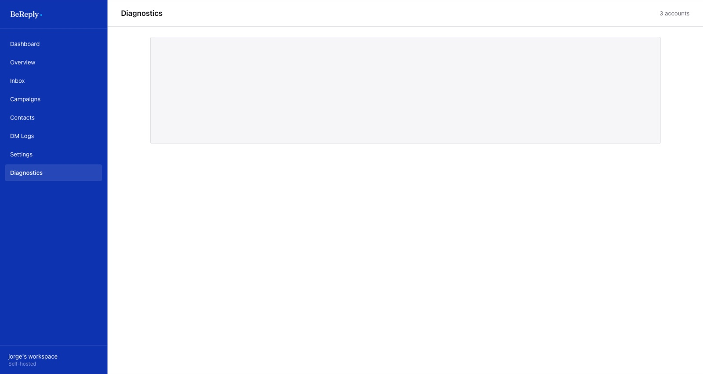

# Problemas frecuentes

| Pasa esto | Revisa |
|---|---|
| Comentaron la palabra y no llegó nada | Que la campaña esté *Active*, que sea de la cuenta correcta y del post correcto. Luego **DM Logs**: si no hay registro, el comentario no llegó a BeReply (ver abajo) |
| No aparece ningún registro en DM Logs | Que la cuenta diga "Webhook ready" en **Settings**. Si es una cuenta nueva, que haya aceptado la invitación de evaluadora de Meta |
| Llegó el DM pero sin el link | Si la campaña tiene follow gate, el link llega después de que la persona toca el botón y sigue a la cuenta |
| *Failed* por la ventana de 24 horas | La persona escribió hace más de 24 horas. Meta no deja contestar hasta que vuelva a escribir |
| La IA no contestó | Mira **DM Logs**: si dice *Escalated*, la IA lo pasó a una persona a propósito. Contesta desde **Inbox** |
| La IA respondió algo de otra marca | La cuenta no tiene conocimiento propio y usó el del workspace. Vincúlala a su marca en Maasy |
| La ficha de Maasy no se actualiza | **Sync now** en **Settings → Brand knowledge**. Si falla, avisa a Believe: Maasy o BeGateway pueden estar caídos |
| No encuentro la invitación de Meta | Entra desde un navegador, no desde la app: `instagram.com/accounts/manage_access/`, pestaña **Invitaciones de evaluador** |
| Instagram muestra otra cuenta al conectar | Cierra sesión en Instagram en ese navegador, entra con la de la marca y vuelve a **Connect another account** |
| El token de una cuenta vence pronto | Se renueva solo cada día. Si la fecha no avanza, avisa a Believe |

## Diagnostics

**Diagnostics** junta en una pantalla lo que salió mal: alertas recientes del envío, fallas y omisiones por campaña, webhooks que fallaron, renovaciones de token que fallaron y la línea de tiempo de eventos. Es lo primero que hay que mirar cuando algo no cuadra.

