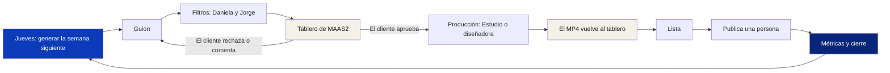

# Qué es BeFeed

BeFeed es donde se controla el Instagram orgánico de cada marca. Ahí se genera la semana, se decide quién hace cada pieza, se producen Reels y se aprueba. El tablero de MAAS2 es la vitrina: ahí lo ve el cliente, ahí comenta y ahí queda el archivo de media de la marca.

Entras en [reply.believe-global.com/feed](https://reply.believe-global.com/feed) con el mismo usuario de BeReply. Un clic en **BeReply** o **BeFeed**, en el menú, te lleva de uno a otro.

## El ciclo

_Figura 1: el ciclo de una semana en BeFeed._

## Tres reglas que no cambian

1. **El agente propone, las personas deciden.** Ni el agente ni el Estudio aprueban o publican. Esas herramientas no existen para ellos.
2. **Nada inventado.** Lo que no está en la estrategia, la voz o la materia prima queda como dato por resolver, y la pieza queda frenada con el nombre de quien lo tiene.
3. **BeFeed manda.** Lo que pasa en el tablero vuelve a BeFeed, pero la operación se administra aquí.

## Las pantallas

| Pantalla | Para qué |
|---|---|
| **Hoy** | Lo que está esperando a alguien y lo último que pasó |
| **Semana** | Las piezas por columnas, de guion a publicada |
| **Estudio** | Los Reels que se producen aquí |
| **Métricas** | Vistas, alcance, tiempo medio y tasa de salto de cada Reel |
| **Ideas** | Tus ganadores y las cuentas de referencia |
| **Cierres** | Qué funcionó, qué se suelta y qué se repite |
| **Marca** | Lo que el agente sabe de esta marca |
| **Cuentas** | Las cuentas de Instagram y su proyecto en MAAS2 |
| **Agente** | Los accesos de Claude o George, y la versión del método en uso |
