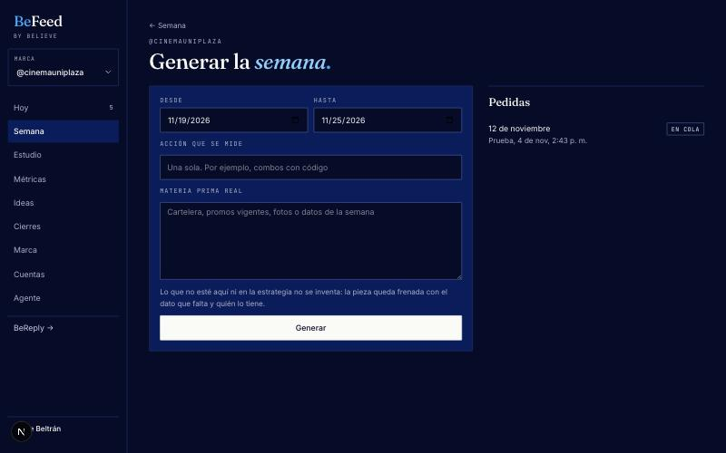

# Generar la semana

**Los jueves, con la semana vigente corriendo, se genera la siguiente.**

1. Elige la marca en el selector de arriba a la izquierda.
2. **Semana → Generar semana.**
3. Revisa las fechas. BeFeed propone los siete días que siguen a la última semana.
4. Escribe **la acción que se mide**: una sola, por ejemplo combos con código o boletas en línea.
5. Pega la **materia prima real**: cartelera, promociones vigentes, datos de la semana.
6. Pulsa **Generar**.

Tarda unos minutos. La pantalla se actualiza sola y, cuando dice **Lista**, el enlace abre la semana.

## Qué usa para escribir

- El método de Believe, en su última versión.
- La estrategia de la marca en MAAS2: pilares, ritmo y reglas.
- La voz de la marca en Maasy, con sus palabras prohibidas y sus llamados a la acción.
- El último cierre y los ganadores de la propia cuenta.
- Lo que escribiste en el formulario.

Cada texto pasa por el linter de voz. Lo que falla vuelve una vez al modelo con el motivo, y lo que siga fallando queda marcado como **Linter pendiente**.

## Lo que queda frenado

Si falta una cifra, una película, un precio o una condición, el texto queda con `{{dato}}` y la pieza queda **frenada** con el nombre de quien lo tiene. Aparece en **Hoy**. Cuando tengas el dato, corrige el texto y suelta la pieza.

Además, BeFeed revisa cada cifra del texto. Si una no aparece en la estrategia, en la voz ni en lo que escribiste, la pieza también queda frenada, con esa cifra en el motivo. Puede ser una falsa alarma: confírmala o quítala.

## Otra vez la misma semana

Una semana que ya tiene piezas no se genera de nuevo. Para repetirla, abajo en **Semana**, abre **Borrar esta semana**. No se puede borrar una semana con piezas publicadas o que ya estén en el tablero del cliente.

> **Cuánto cuesta:** generar una semana solo gasta en el modelo de texto, centavos de dólar. Lo caro es producir Reels, y eso va por etapas.
