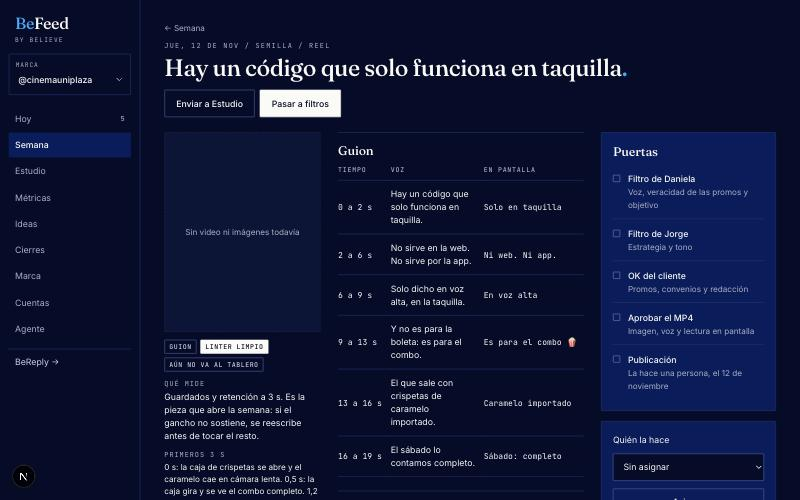

# Piezas y puertas

Cada pieza avanza por columnas: **Guion, Filtros, Cliente, Video, Lista, Publicada**. Solo avanza cuando una persona abre la puerta que sigue.

| Puerta | Quién | Qué pasa al abrirla |
|---|---|---|
| Filtro de Daniela | Daniela | Sigue el de Jorge |
| Filtro de Jorge | Jorge | La pieza se copia al tablero del cliente |
| OK del cliente | El cliente, en el tablero | Se puede producir el video |
| Aprobar el MP4 | El cliente, en el tablero | Queda lista para publicar |

También se pueden abrir desde la pieza, en BeFeed, cuando el cliente aprueba por otro medio.

## Quién la hace

En la pieza, **Quién la hace** tiene dos caminos: **Estudio de BeFeed**, o una persona del equipo. La persona aparece en la tarjeta de la semana y en el tablero como responsable.

## Subir lo que hizo una diseñadora

En la pieza, usa **subir archivos** para el MP4 o las imágenes: se ven ahí mismo y se copian al tablero. Un MP4 pesado se puede adjuntar por link. **Un video nuevo siempre se vuelve a aprobar**, aunque el anterior ya estuviera aprobado.

## Pedir cambios

**Pedir cambios** devuelve la pieza a guion con todas las puertas cerradas: el texto cambió, así que se revisa de nuevo. Lo que ya está en revisión no se puede reescribir sin este paso. Tampoco el agente puede hacerlo.

## Frenar una pieza

Si la pieza espera algo de alguien, escribe quién y qué falta. Una pieza frenada no abre puertas. Se suelta guardando el nombre vacío.

## Publicar

Publica una persona, con la herramienta de siempre. Después, en la pieza lista, **Ya la publicaste** te pide elegir la publicación real. Eso la une con sus métricas y la marca como publicada también en el tablero.
